# Technical Risk Treatment: Implementing and Validating Security Controls

**Student:** Chioma Ameh | **Registration No.:** C11/26/CGRCE/17567 | **Course:** GRC103 - Module 3 practical (ICDFA) | **Date:** 10 November 2026
**Repository:** https://github.com/ChiomaAmeh/grc103-technical-risk-treatment-lab | **PDF version:** `Technical_Risk_Treatment_Report_Chioma_Ameh_C11-26-CGRCE-17567.pdf` | **Demonstration:** link in the repository README (top table) and in the submission.

> Measured results come from my own isolated lab (Ubuntu Server + Kali on a VirtualBox host-only network, fictional data only). Approvals, owners, the managed-backup offer, costs and annual-loss figures are **simulated or assumed**. Missing evidence is stated, not invented.

## 1. Lab environment
- Host: HP laptop, Intel Core i7 8th gen, Windows 11 Pro; hypervisor: **Oracle VirtualBox**
- Ubuntu Server 24.04.5 LTS (2 vCPU, 2 GB RAM, 25 GB disk), hostname `ubuntu`: IP **192.168.56.20** (enp0s8) | Kali Linux 2025.4: IP **192.168.56.101** (eth1) | Network: host-only `VirtualBox Host-Only Ethernet Adapter`, 192.168.56.0/24. A temporary second address, 192.168.56.30, was added on Kali as the *unapproved* test source.
- Software: Nginx 1.24.0, UFW 0.36.2, Python 3.12 (legacy endpoint), curl, nmap 7.95.
- NAT: used only to install packages; Ubuntu's NAT interface was then taken down (`sudo ip link set enp0s3 down`) at about **09:56 WAT on 9 Nov 2026** (screenshot 05), before the real baseline scan at 12:48 WAT. Kali's NAT stayed up only to push to GitHub.
- Checkpoint: Kali's VirtualBox snapshot **'Snapshot 1'** existed before the lab (screenshots 01, 01b). Ubuntu was created from scratch for this lab, so its clean starting point is the fresh installation (screenshots 00a-00e); no snapshot was taken before the baseline build. The server was built by repeatable scripts (`scripts/u1_build.sh` ... `u7_ship.sh`) and every change has a documented rollback (Section 8, `records/02`).
- Console limitation: the VirtualBox text console cannot paste, so long command sequences were saved as scripts, served from Kali, downloaded to Ubuntu and run on the Ubuntu console.
- Clock limitation: Ubuntu had no time sync (NAT down); its clock drifted and stopped while the VM was paused. The offset to Kali was measured per test group (about 4-15 min on 9 Nov; about 8 h 45 min-8 h 57 min on 10 Nov).
- All data fictional; own lab systems only; no passwords, keys or disk images included.

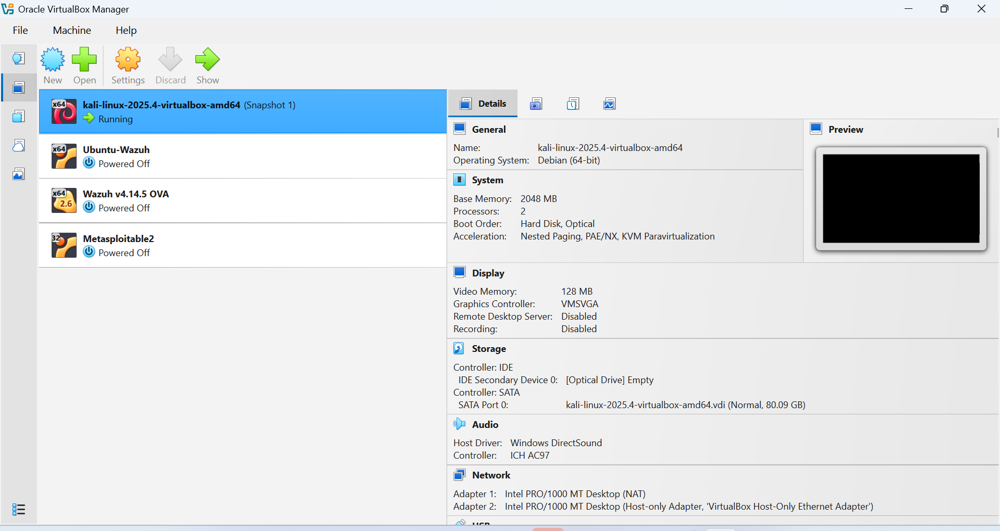
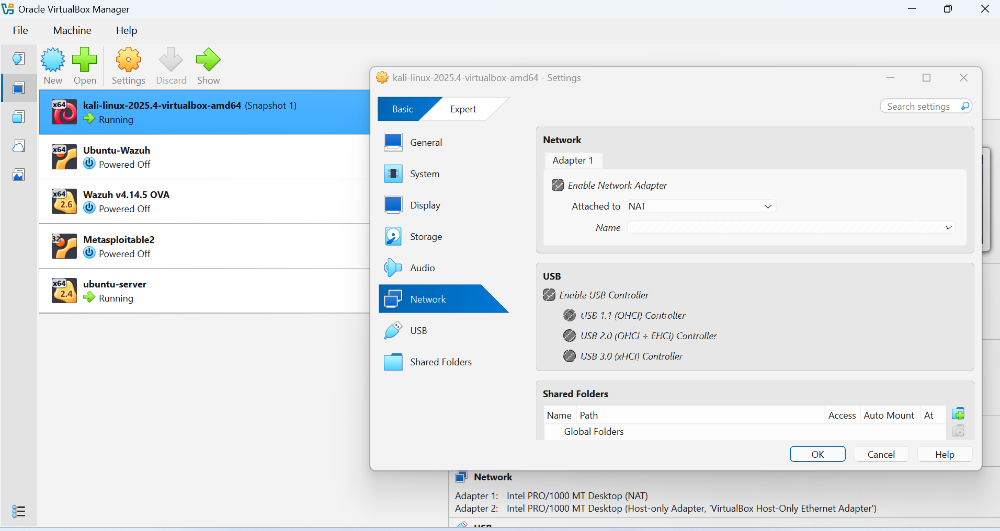
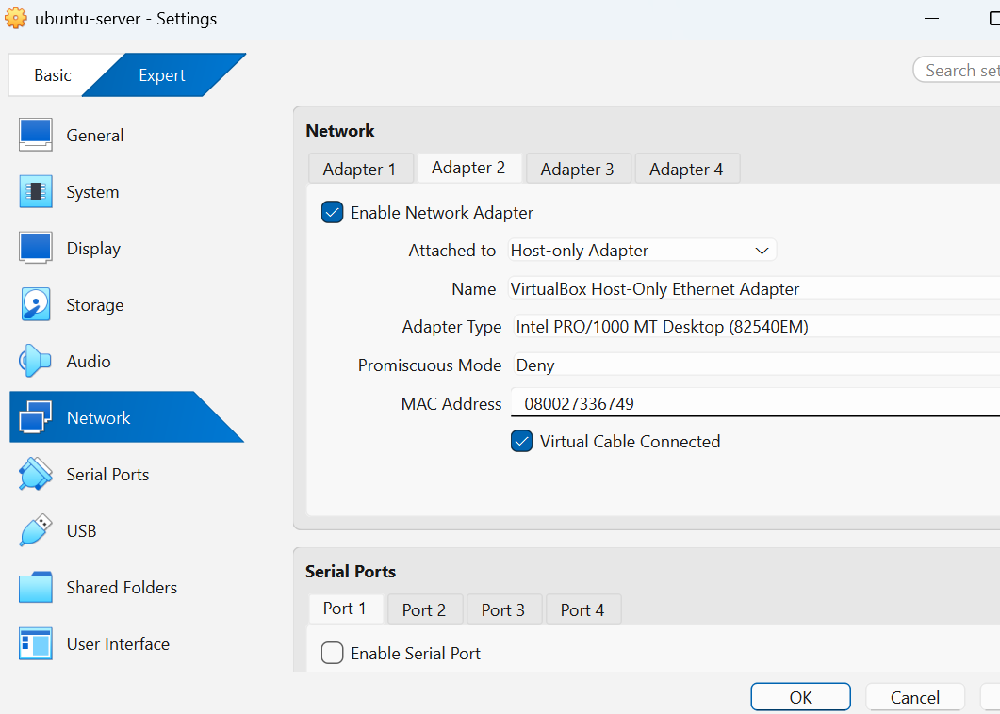
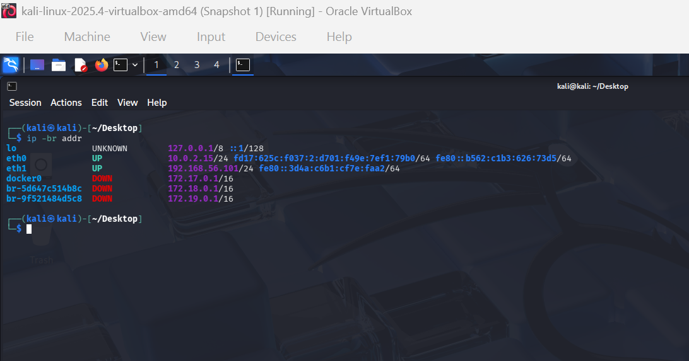
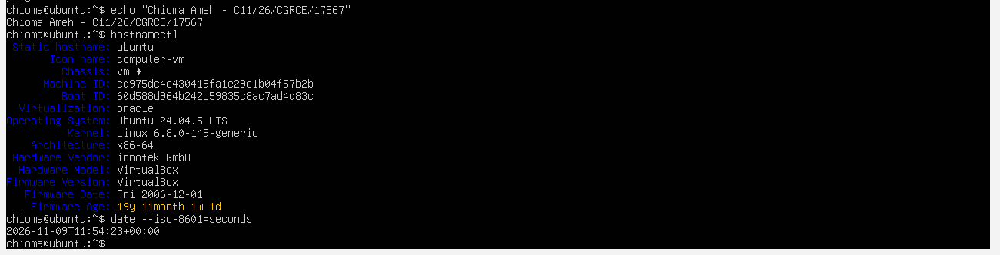

## 2. Baseline and risk register (Steps 4-5)
Baseline from Kali, 9 Nov 2026 12:48 WAT (an earlier run, before the services existed, was discarded).

| Test | Result observed |
|---|---|
| nmap -p 80,8080 | 80/tcp open (http), 8080/tcp open (http-proxy) |
| GET / | 200, Nginx directory listing showing `archive/` and `public/` |
| GET /archive/ | 200, listing of `dummy-records.txt` |
| GET /archive/dummy-records.txt | 200, "DUMMY RECORD A001 - training only" |
| GET :8080/ | 200 from Python SimpleHTTP, "Legacy training endpoint" |
| Ubuntu `ufw status` | inactive |
| Ubuntu `ss -lntp` | 0.0.0.0:8080 (python3) and 0.0.0.0:80 (nginx) |

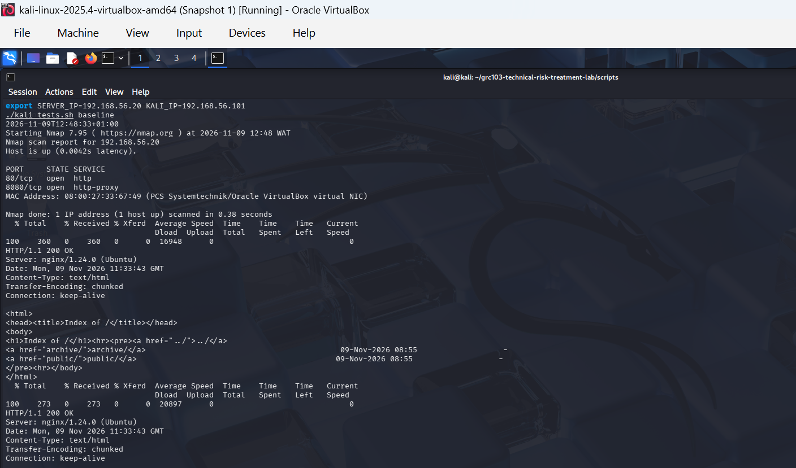
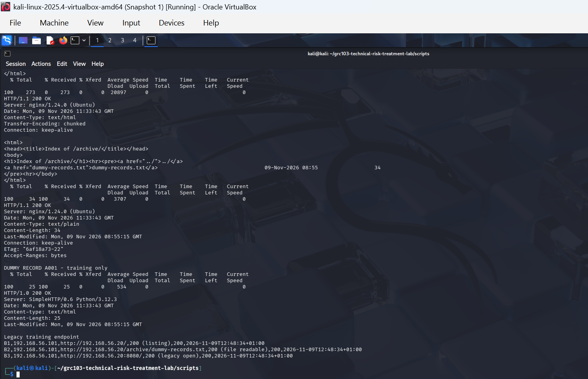
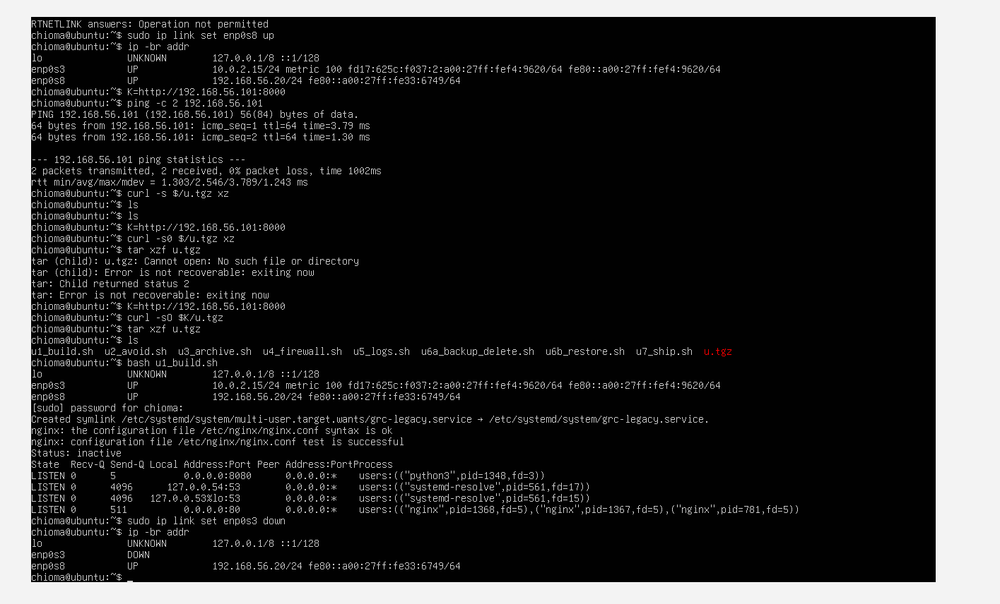

| ID | Asset / threat | Weakness (evidence) | L | I | Score | Owner (simulated) |
|---|---|---|---|---|---|---|
| R1 | Legacy endpoint :8080 | Open, no business need | 4 | 3 | 12 High | IT Operations Manager |
| R2 | /archive records | Listing on; file downloadable | 4 | 4 | 16 High | Data Owner |
| R3 | Network exposure | No firewall | 4 | 3 | 12 High | Security Lead |
| R4 | Portal content | No backup | 3 | 3 | 9 Medium | Service Owner |

Scale: likelihood x impact (1-5 each); bands 1-4 Low, 5-9 Medium, 10-16 High, 17-25 Critical (ordinal judgements, not money).

## 3. Avoidance and continuity (Step 6, CHG-01)
`sudo systemctl disable --now grc-legacy` (u2_avoid.sh, 9 Nov 11:38:49 UTC Ubuntu clock). Result: port 8080 open -> closed; legacy endpoint 200 -> no response (A1); approved portal `/public/` stays **200** (A2); service inactive/disabled; only port 80 listening.
**Rollback tested:** re-enabled 12:44:59 UTC (8080 listening, Kali received "Legacy training endpoint"), disabled again 12:48:37 UTC, final Kali test: 8080 closed, portal 200.

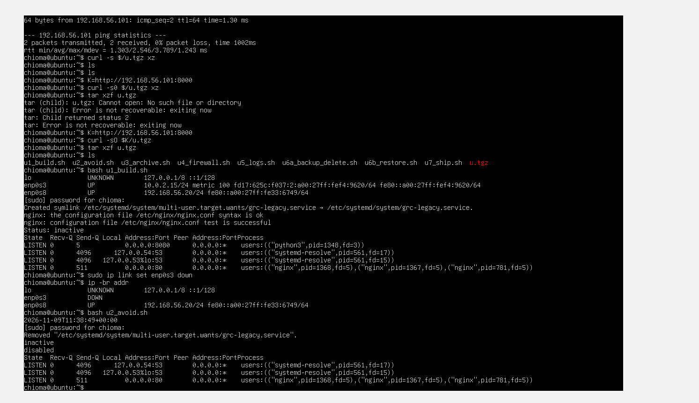
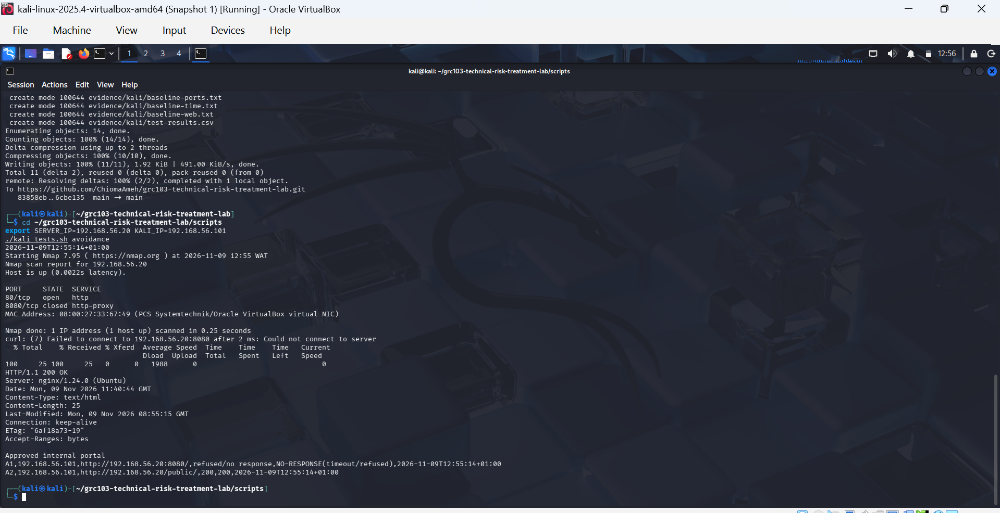
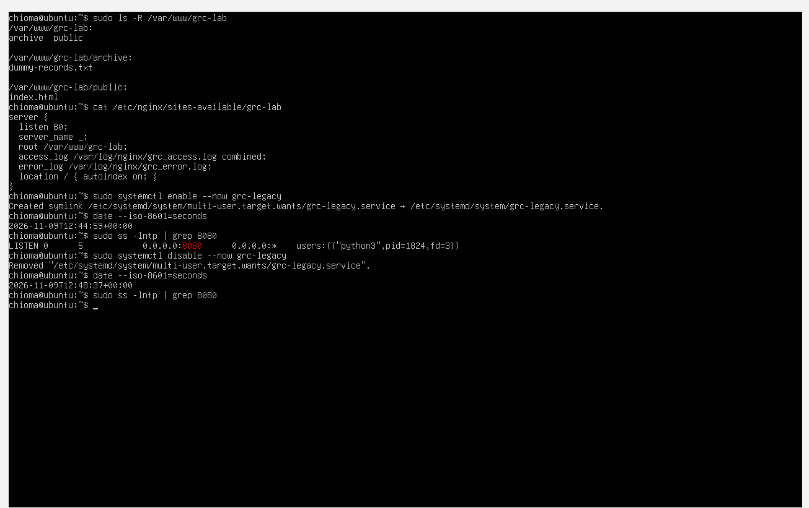
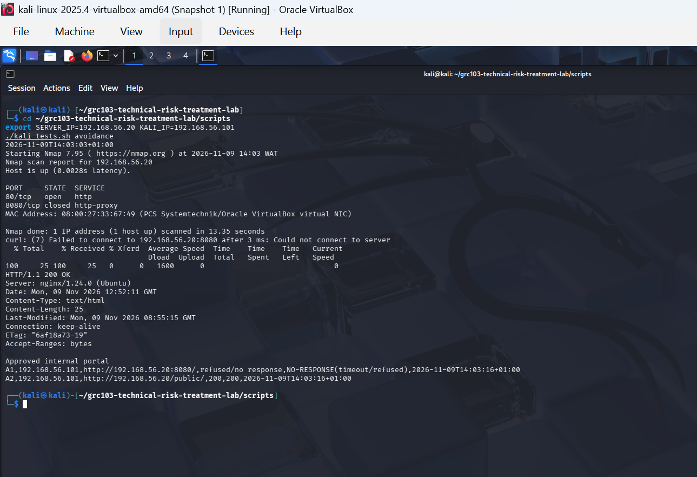

**Why avoidance does not eliminate all risk:** it removes only the legacy workflow's exposure. Nginx on port 80, the operating system, plain-HTTP traffic, data in the web root and file loss are separate risks needing their own controls (R2-R4).

## 4. Archive protection and firewall (Steps 7-8)
**Archive (CHG-02, ~14:02 UTC Ubuntu clock):** moved to `/srv/grc-private` (`drwx------ root root`), `autoindex off`, `location /archive/ { deny all; }`, Nginx test and reload.

| Test | Before | After |
|---|---|---|
| /public/ | 200 | 200 (P1) |
| / | 200 (listing) | 403 (P2) |
| /archive/ | 200 (listing) | 403 (P3) |
| /archive/dummy-records.txt | 200 (file) | 403 (P4) |

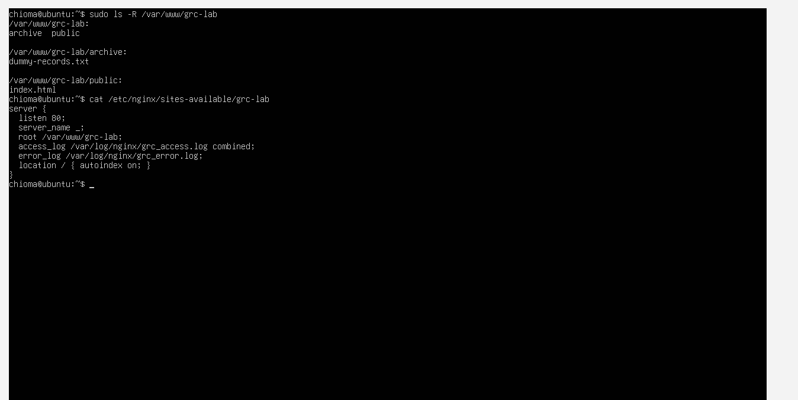
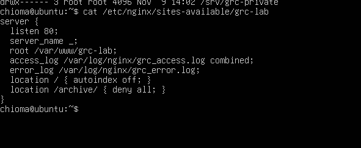
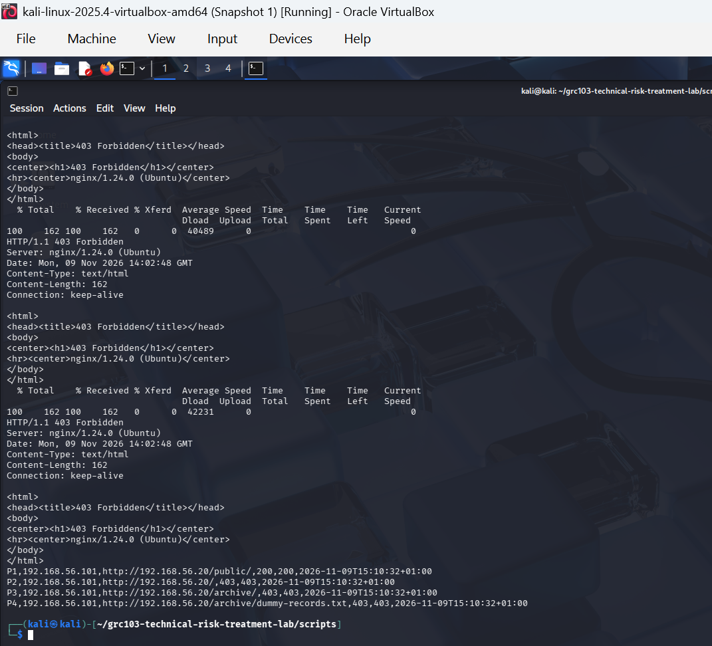

**Why `autoindex off` alone is not enough:** it only stops Nginx generating a file list. Anyone who knows the exact file URL can still download the file while it sits inside the web root. Real protection needs the file moved out of the web root, restrictive permissions and an explicit deny.

**Firewall (CHG-03):** UFW default deny incoming, allow outgoing, allow only `192.168.56.101` to tcp/80, logging on (low), enabled.

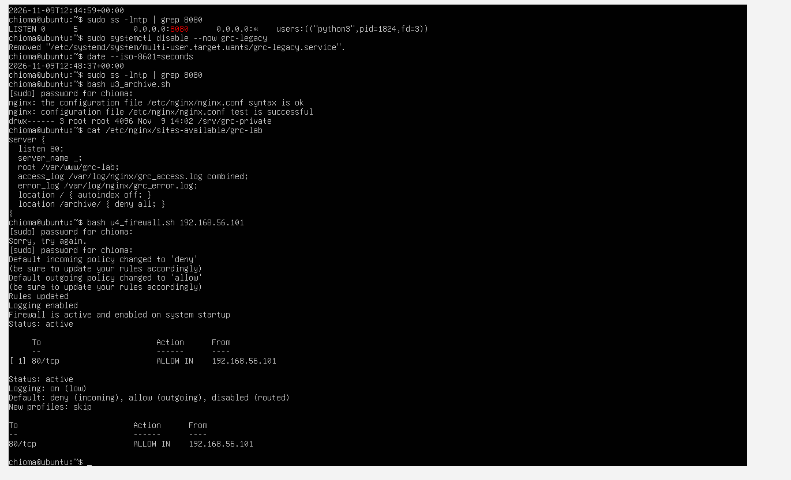

| Test | Source | Expected | Actual | Kali timestamp (UTC+1) |
|---|---|---|---|---|
| F1 | 192.168.56.101 (approved) | 200 | 200 | 2026-11-09T15:59:46 |
| F2 | 192.168.56.30 (unapproved) | timeout | no response | 2026-11-09T16:22:51 |
| F3 | 192.168.56.30 (unapproved) | timeout | no response | 2026-11-09T16:22:59 |

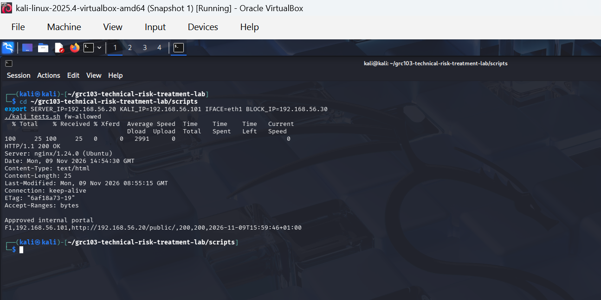
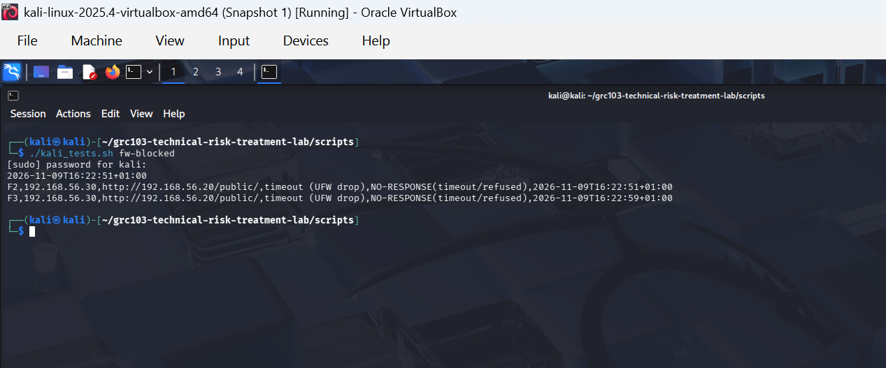

## 5. Log correlation (Step 9)
Full table with offsets: `records/04_evidence_table.md`.

| Test | Kali time | Ubuntu log line (Ubuntu clock) | Offset |
|---|---|---|---|
| P1-P4 | 2026-11-09 15:10:32+01:00 | 14:02:48 GET /public/ 200; / 403; /archive/ 403; file 403 | 7 min 44 s |
| F1 | 2026-11-09 15:59:46+01:00 | 14:54:30 GET /public/ 200 | 5 min 16 s |
| F2 | 2026-11-09 16:22:51+01:00 | kernel `[UFW BLOCK] SRC=192.168.56.30 DPT=80 SYN` 15:18:44, 45, 47, 48, 49 | 4 min 07 s |
| F3 | 2026-11-09 16:22:59+01:00 | `[UFW BLOCK]` SRC=192.168.56.30, 15:18:53-57 | 4 min 06 s |
| L1/L2 run 1 | 2026-11-10 08:53:17 / :19+01:00 | 23:07:24 / :26 (200 / 403) | 8 h 45 min 53 s |
| L1/L2 run 2 | 2026-11-10 09:25:26 / :28+01:00 | 23:28:24 / :26 (200 / 403) | 8 h 57 min 02 s |

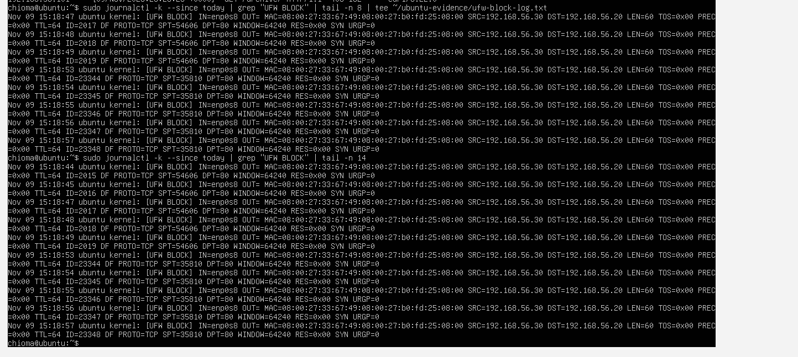
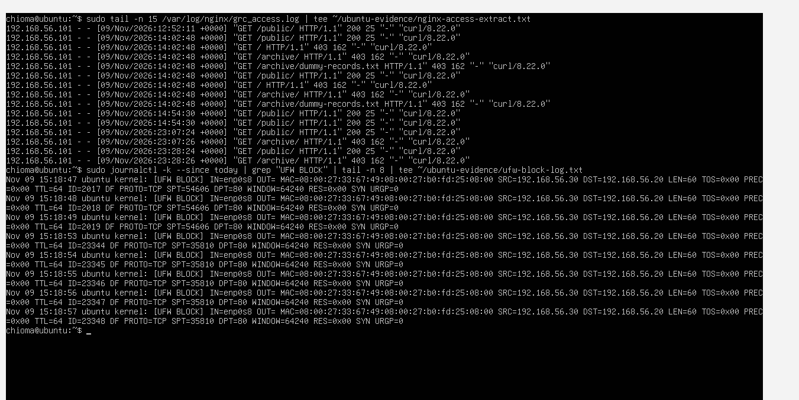
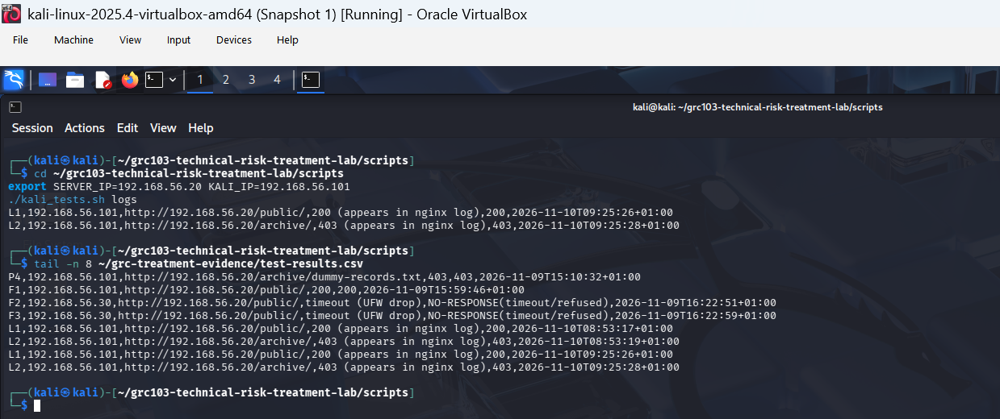

**Which requests appear in Nginx logs, and why blocked traffic does not:** Nginx logs only requests that reach it - the approved Kali client's `/public/` (200) and protected paths (403). UFW drops the unapproved source's SYN packets in the kernel before a connection reaches Nginx, so there is **no Nginx entry for 192.168.56.30**; the evidence is the kernel `[UFW BLOCK]` log (SYN only, handshake never completed) and the client timeout.

## 6. Backup and verified restoration (Step 10, CHG-04)

| Step | Evidence |
|---|---|
| Backup | `/srv/grc-backups/public-before-test.tgz` (177 bytes, directory mode 700), 9 Nov 23:52 Ubuntu clock |
| Hash before | `e5b34d9b4fa6452b6b1d292b0ced654c99977f7ebece28a2731f633f53a50f72` |
| Simulated loss | `index.html` deleted 2026-11-09T23:52:22+00:00 |
| Impact | Kali `/public/` = **403** (R1, 2026-11-10T09:49:00+01:00) |
| Restore | `sha256sum -c` = **OK**, completed 2026-11-10T00:00:33+00:00 |
| Availability | Kali `/public/` = **200** (R2, 2026-11-10T09:57:41+01:00) |
| **Observed recovery time** | **490 seconds** |

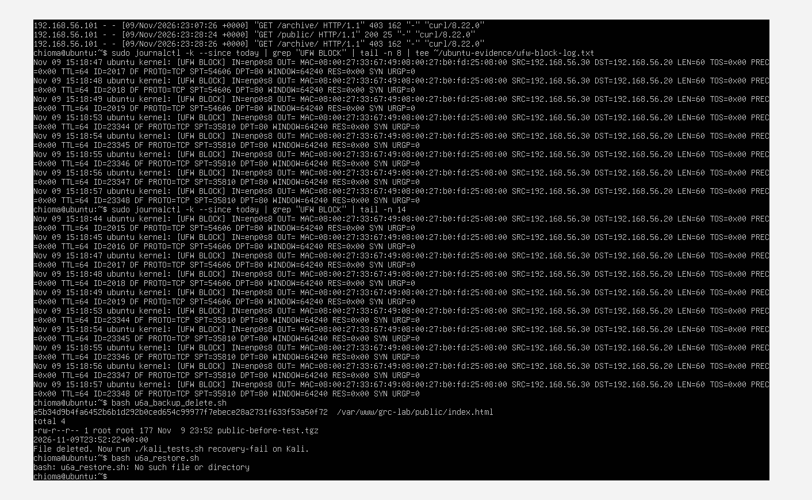
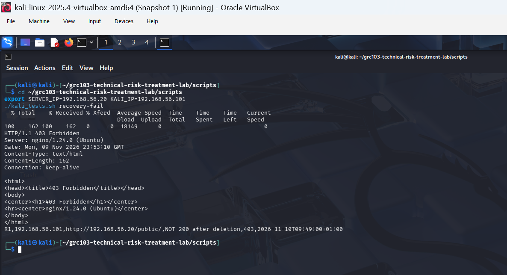
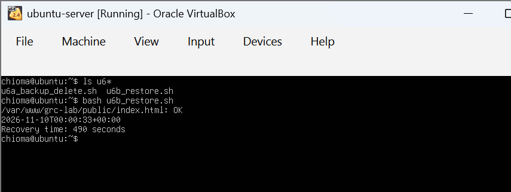
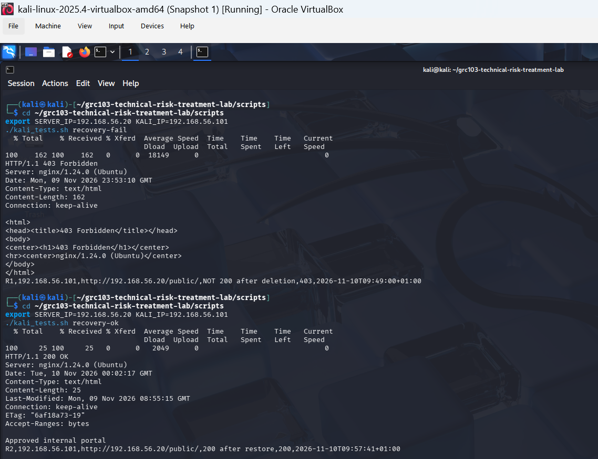

The 490 s includes the Kali check and a mistyped command; the restore itself took about a second. **Same-host limitation:** the tarball is lost together with the host (disk failure, destruction, ransomware), so off-host copies are needed - the reason for the transfer option.

## 7. Treatment decisions, costs, residual risk (Steps 11-12)
Approvals simulated; prices and loss figures assumed. Full records: `records/03_treatment_decision_records.md`.

| Strategy | Decision | Owner |
|---|---|---|
| **Avoidance** (R1) | Retire the legacy endpoint - no business value, exposure removed at no running cost | IT Operations Manager |
| **Mitigation** (R2-R4) | Archive moved + root-only + deny; UFW default-deny with one source; Nginx/UFW logs; hash-verified backup | Data Owner / Security Lead / Service Owner |
| **Transfer** (R4, host loss) | Managed off-host backup, fictional $120 + $20/month. Provider: encrypted off-site backups, versions, restore support. Customer keeps: data classification, credentials, quarterly restoration tests (SHA-256, time recorded), evidence 12 months. Provider restores backups only; a contract does not remove the technical risk. No purchase made. | Service Owner |
| **Acceptance** (plain HTTP) | Temporary, 14 days (to 2026-11-24, review 2026-11-17), dummy data, isolated network, one allowed source; residual 2 x 2 = 4 Low. Void and TLS implemented if real data, external/bridged connectivity, more clients/wider network, or a purpose change appears. | Service Owner |

| Option | Calculation | First-year cost |
|---|---|---|
| A Hardening | 4 h x $25 + $50 | $150 |
| B Managed backup | $120 + $20 x 12 | $360 |
| C TLS | 3 h x $25 + $25 | $100 |
| **A + B + C** | 150 + 360 + 100 | **$610** |

Illustrative scenario (assumed): ARO 0.2; loss $5,000 -> $1,000 with tested recovery. Baseline ALE = 0.2 x 5,000 = $1,000; residual ALE = 0.2 x 1,000 = $200; annual benefit $800; first-year net benefit of Option B = 800 - 360 = **$440**. The recovery test does not prove these figures; overlapping benefits are not added.

| ID | Baseline | Residual (L x I) | Score | Basis (tested) | Remaining weakness |
|---|---|---|---|---|---|
| R1 | 12 High | 1 x 3 | 3 Low | 8080 closed; rollback proven | Could be re-enabled by mistake |
| R2 | 16 High | 2 x 4 | 8 Medium | 403 for /, /archive/, file | Plain HTTP; source-IP allow-list |
| R3 | 12 High | 2 x 3 | 6 Medium | Approved 200; unapproved dropped + UFW BLOCK | IP spoofing on shared network; no TLS |
| R4 | 9 Medium | 2 x 3 | 6 Medium | Restore OK in 490 s | Backup on the same host |

## 8. Change and rollback records (approvals simulated)
| Field | CHG-01 Legacy | CHG-02 Archive | CHG-03 UFW | CHG-04 Backup |
|---|---|---|---|---|
| Executed (Ubuntu clock) | 9 Nov 11:38:49 UTC | 9 Nov ~14:02 UTC | 9 Nov, between 14:02 and 14:54 UTC | 9 Nov 23:52:22 UTC; restored 10 Nov 00:00:33 UTC |
| Rollback | `systemctl enable --now grc-legacy` | restore baseline conf, move archive back, reload | `sudo ufw disable` (console) | restore from tarball |
| Rollback tested? | **Yes** (12:44:59 on, 12:48:37 off) | Documented, not tested | Documented, not tested | **Yes** |
| Final state | Legacy disabled | Archive private | UFW active | Portal restored |

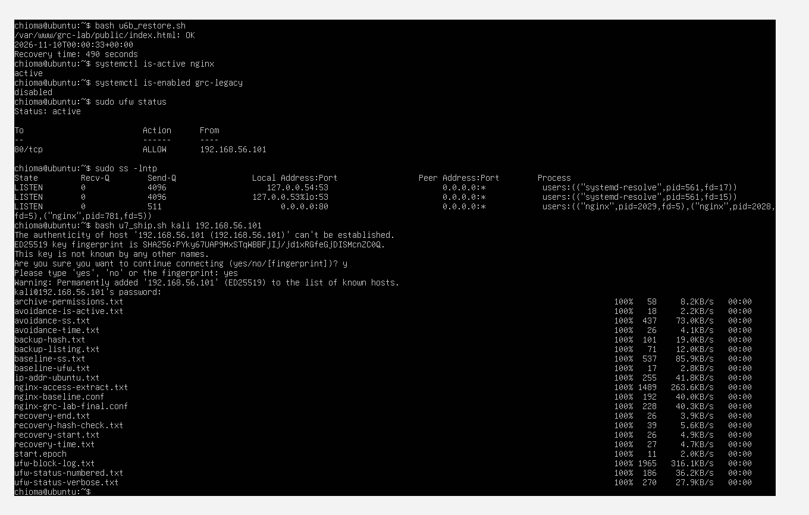

## 9. Monitoring plan (proposed - not measured)
| # | Check | Owner | Frequency | Threshold | Escalation |
|---|---|---|---|---|---|
| M1 | Portal availability (curl /public/) | Service Owner | 5 min | Non-200 twice | Page IT Ops; restore after 15 min |
| M2 | Unexpected open ports (nmap vs 80 only) | Security Lead | Daily | Any other port | Incident within 1 h |
| M3 | Restore + `sha256sum -c` | Service Owner | Monthly | Mismatch or > 15 min | Fix within 5 business days |
| M4 | `grc-legacy` not enabled; 8080 closed | IT Ops Manager | Daily | Enabled/open | Change-control breach; disable and review |
| M5 | `ufw status numbered` as expected | Security Lead | Daily | Inactive or extra rules | Restore ruleset; incident |

## 10. Management summary
The server exposed an unnecessary legacy service and a browsable record directory, with no firewall and no backup. Measured outcomes: port 8080 closed while the portal stayed at 200 (rollback proven); direct access to the records file went 200 -> 403; only the approved client reaches the portal while an unapproved source times out and is recorded as `[UFW BLOCK]` with no Nginx entry; a deleted file was restored with a matching SHA-256 in 490 s. Residual: R1 3 Low, R2 8 Medium, R3 6 Medium, R4 6 Medium (plain HTTP, source-IP trust, same-host backup). Recommendation (assumed costs): keep Option A, add TLS ($100) and a managed off-host backup ($360) - $610 in total - and accept plain HTTP only temporarily (14 days). Decisions needed: approve the 14-day acceptance and the TLS + backup budget (simulated).

## 11. Evidence index
See the repository `README.md` (table mapping every lab step to its files) and `evidence/screenshots/INDEX.md`.

## 12. Limitations
- A single allowed source IP is a weak identity control on a shared network; production needs authentication and TLS.
- Ubuntu's clock was unsynchronised; correlation used measured offsets plus request sequence and spacing.
- The recovery time includes manual steps; the backup is on the same host.
- Rollback for CHG-02 and CHG-03 is documented, not executed; CHG-01 and CHG-04 were executed.
- Costs, ALE figures, contract terms and all approvals are simulated or assumed.
